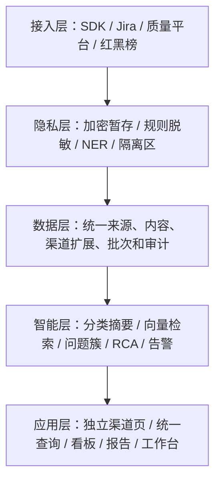
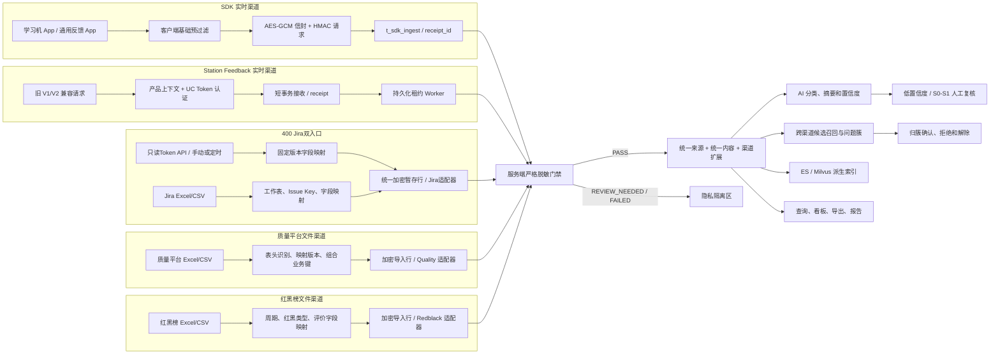

# 交付物 04：系统架构与五渠道数据流

## 1. 五层架构

系统分为接入、隐私处理、统一数据、智能分析和应用展示五层。MySQL 保存权威业务事实；Redis 用于 nonce 和运行时辅助能力；Elasticsearch、Milvus 是可重建索引，不能成为统计真相源。

## 2. 五渠道完整数据流图

五个来源分别呈现；Station Feedback 与 SDK 都是实时 API 接入，但保持独立渠道、安全契约和指标口径。

## 3. 为什么采用四种接入方式

| 渠道 | 方式 | 原因 | 是否回写 |
|---|---|---|---|
| SDK | HMAC 鉴权的加密 API，实时/准实时 | 需要弱网暂存、反馈回执、附件续传和平台内状态处理 | 只更新平台处理状态 |
| 400 Jira | 后端Token只读API增量拉取，同时保留导出文件增量导入 | API改善新鲜度；文件承担历史补数、人工修复和外部故障降级；两者共用Issue Key幂等与脱敏链 | 不回写 |
| 质量平台 | 现有 Excel/CSV 导入 | 表头和业务键具有质量平台口径，需要配置化适配 | 不回写 |
| 红黑榜 | 现有 Excel/CSV 导入 | 周期、红黑类型和评价维度不能被其他渠道口径覆盖 | 不回写 |

## 4. 任务隔离与降级

- SDK 接收与耗时处理解耦，先返回加密接收 ACK。
- Jira API和三类文件各自形成批次；一个批次失败不影响 SDK 或其他接入方式。
- 导入 worker 一轮内按渠道公平领取，避免一个大批次长期独占。
- AI、索引、报告和通知使用独立任务状态、租约和重试。
- ES/Milvus 不可用时普通 MySQL 查询与统计继续运行；AI 不可用时使用规则或 SQL 事实降级。
- 普通出口始终要求 `masking_status=PASS`，降级不能绕过隐私门禁。

## 5. 图件清单

统一架构的文字细节见 `../reference/technical-architecture.md`。

可直接用于汇报的图：

- `../../../docs/images/architecture/2.1-five-layer-architecture.png`
- `../../../docs/images/architecture/2.2-sdk-reporting-flow.png`
- `../../../docs/images/architecture/2.3-table-import-flow.png`
- `../../../docs/images/architecture/2.4-async-pipeline.png`
- `../../../docs/images/architecture/2.5-alert-routing-flow.png`

架构原则：MySQL 是业务权威源；ES/Milvus 为可重建派生索引；SDK 接收、文件导入、脱敏、AI、索引、报告和告警使用隔离任务；模型和外部通知失败不阻断接入与普通查询。
