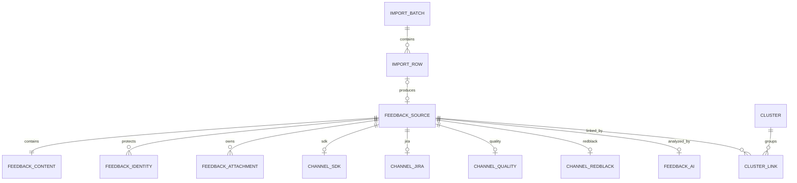

# 交付物 05：数据库设计与 ER 图

数据库当前保持44张物理业务表。MySQL是业务事实源，Flyway管理结构版本，Hibernate使用`validate`而不是自动建表。V176新增`t_jira_sync_state`，V178在既有批次和SDK信封表上增加处理契约版本/快照列；兼容视图、索引和触发器不计入该数字。

> **本表的清点基线是 V178**：44 是那一刻的物理业务表数，本文不随迁移滚动更新。
> V178 之后新建的 13 张表（V242 的 11 张 RCA 运行时表、
> V244 的 `t_rca_domain_event`、V245 的 `t_auth_tenant`）**不在本文范围内**，
> 见 `29-rca-agent-runtime.md`。
> 2026-10-09 在部署库实测为 90 张 BASE TABLE（`information_schema`），
> 与 44 的差额同时包含本文之后的迁移和部署库自身的差异，
> **不要把 90 当成新的权威常数**——权威来源始终是 `db/migration/` 与 Flyway 历史。

## 1. 领域划分

| 领域 | 核心对象 | 关系说明 |
|---|---|---|
| 反馈核心 | `t_feedback_source`、`t_feedback_content`、`t_feedback_identity`、`t_feedback_attachment` | 来源与正文一对一；身份和附件是一对多安全扩展 |
| 渠道扩展 | `t_channel_sdk`、`t_channel_jira`、`t_channel_quality`、`t_channel_redblack` | 每条统一来源最多一个对应渠道扩展 |
| 导入与同步 | `t_import_batch`、`t_import_row`、`t_jira_sync_state`、上传分片 | 文件/API批次包含统一暂存行；Jira状态表保存水位、租约和安全错误，不保存Token；行可关联正式来源 |
| 脱敏 | 脱敏审计、规则/评估配置 | 保存规则版本、命中类型和安全评估事实，不保存普通日志原文 |
| AI/报告 | `t_feedback_ai`、`t_ai_task`、`t_ai_report`、知识库 | 任务保存可审计快照，结果不覆盖来源原始字段 |
| 归簇 | 问题簇、关联和审核事实 | 来源记录保留，活跃 MAIN 关联表达当前去重归属 |
| 告警通知 | 告警实例、通知和治理配置 | 告警证据与业务事实关联，投递失败不改业务源数据 |
| 权限审计 | 用户、角色、权限、数据范围、系统审计 | API 权限与 CHANNEL/MODULE/REGION/FIELD 数据权限分离 |

## 2. 核心 ER 图

## 3. 关键约束

- `source_channel + source_record_id` 是统一来源幂等边界。
- `t_import_batch`保存FILE/API接入方式、字段映射版本/快照、枚举映射组合版本/快照和对账计数；文件摘要或API批次摘要均不替代业务键。
- `t_sdk_ingest.schema_version`保存客户端实际使用的表单/字段契约版本；服务端只处理明确支持的版本。
- 正式内容保存脱敏状态、映射/标准化/质量版本；PASS 才能进入普通出口。
- 每条反馈只能有一个活跃 MAIN 问题簇关联；合并拆分保留历史关联。
- SDK receipt、上传文件 ID、任务 key 和外部回执均有独立唯一约束。
- 联系方式只在授权保险库中保存密文和不可逆指纹。

## 4. 统一模型字段字典

| 字段组 | 必要字段 | 写入者 | 使用约束 |
|---|---|---|---|
| 来源 | `source_channel`、`source_record_id` | 四渠道适配器 | 联合唯一；普通用户不可修改 |
| 时间 | `source_event_time`、`source_update_time`、`ingest_time` | 适配器/平台 | 来源更新时间用于旧快照保护 |
| 正文 | 标题、描述、摘要 | 脱敏流水线 | 普通出口只能读取 PASS 版本 |
| 标准化 | 应用、模块、版本、类型、严重度、标准状态 | 映射/复核 | 不覆盖来源口径字段 |
| 治理 | `masking_status`、规则、映射和质量版本 | 治理流水线 | 变化保存审计和处理时间 |
| 关联 | AI 结果、问题簇、证据和置信度 | AI/归簇服务 | 可解除错误关联，不删除来源 |

渠道专属字段分别存入四个扩展域。Jira 的 Issue Key 是来源记录 ID；质量平台沿用现有组合业务键生成规则，不因统一模型调整而变化。

## 5. 数据生命周期

导入原始行和 SDK 信封按保留期加密保存，处理成功后清除不再需要的密文材料；统一来源、脱敏正文、审计和对账事实按业务策略保留。ES/Milvus 可以从 MySQL 重建，不作为删除、统计或权限判断的权威源。

| 阶段 | 数据形态 | 允许用途 | 退出条件 |
|---|---|---|---|
| 暂存 | AES-GCM 密文、哈希、安全元数据 | 脱敏、重放、合规追溯 | PASS 后按策略清理或到期销毁 |
| 隔离 | 非 PASS 状态、命中类型、受控密文 | 隐私工作台修复 | 重新脱敏通过或合规销毁 |
| 正式 | 来源元数据、脱敏正文、标准字段 | 查询、统计、AI 和归簇 | 按业务保留策略处理 |
| 派生 | ES 文档、Milvus 向量、缓存 | 搜索和候选召回 | 可从 PASS 正式数据重建 |

备份恢复必须验证Flyway版本、44表契约、Jira同步水位、唯一键和行数对账。恢复ES/Milvus时从MySQL重新同步，不把旧派生索引反向覆盖权威数据。

## 6. 完整图件

- `../../../docs/archive/design/SQL_table_v2.md`
- `../../../docs/images/architecture/3.3.15-er-full.mmd`
- `../../../docs/images/architecture/3.3.17-cross-domain-overview.mmd`
- `../../../docs/images/architecture/3.3.17-er-a-feedback-core.mmd`
- `../../../docs/images/architecture/3.3.17-er-b-import.mmd`
- `../../../docs/images/architecture/3.3.17-er-c-cluster-masking.mmd`
- `../../../docs/images/architecture/3.3.17-er-d-alert.mmd`
- `../../../docs/images/architecture/3.3.17-er-e-ai.mmd`
- `../../../docs/images/architecture/3.3.17-er-f-system.mmd`

Flyway 迁移位于 `backend/src/main/resources/db/migration/`。生产禁止修改历史迁移；新增变更只能添加新版本，并由 `ddl-auto=validate` 检查实体一致性。
