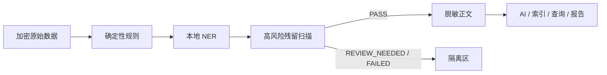

# 交付物 09：脱敏规则、样例与验证报告

## 1. 敏感信息和处理策略

| 类型 | 发现方式 | 默认处理 | 关联方式 |
|---|---|---|---|
| 手机、邮箱 | 确定性规则 | 掩码；联系值进入授权保险库 | 加盐指纹 |
| 姓名、学校、班级、地址 | 规则 + 本地 NER + 残留扫描 | 删除、实体替换或行政区泛化 | 不使用原文关联 |
| 证件、银行卡、凭证 | 高风险规则 | 删除并触发严格门禁 | 禁止普通关联 |
| 账号、员工号、会员号 | 字段规则和上下文 | 令牌化/哈希 | 不可逆指纹 |
| SN、IMEI、MAC、IP | 设备/网络规则 | 删除、掩码或哈希 | 设备指纹 |
| 截图、附件、日志 | 类型校验和隔离 | 无法可靠识别时隔离 | 不进入普通 AI |

## 2. 处理节点

SDK 服务端解密后、表格预览/导入/落库前、AI/向量/第三方调用前、查询/报告/导出前均执行隐私检查。未通过数据进入隔离区，不进入 AI、ES、Milvus、统计或报告。

规则覆盖姓名、电话、邮箱、地址、证件、学校班级、账号和设备/网络标识；确定性规则先运行，再执行本地 NER 和高风险残留扫描。规则版本、命中类型和处理时间可审计，普通日志不记录命中原文。

## 3. 无原文泄漏的证明方法

1. 使用 `data/test-fixtures/full-system-20260805/privacy-masking-cases.csv` 运行脱敏测试。
2. 断言普通查询、搜索、看板、导出和报告只能返回 PASS。
3. 断言隔离记录不会创建 AI、索引同步或问题簇任务。
4. 检查审计、异常和任务错误只保存安全错误码/摘要，不包含夹具中的明文标记。
5. 检查 ES/Milvus 同步输入来自 PASS 查询；删除/隔离记录只产生删除任务。
6. 检查 LLM 调用经过 `AiSafetyGuard`/出站隐私门禁，Prompt 调用快照不保存未脱敏正文。

## 4. 评估门槛和发布

生产候选要求可追溯标注集、独立复核和有效期。软件门禁至少检查 NER F1 ≥ 0.75、端到端 F1 ≥ 0.90、高风险召回率 ≥ 0.98、误脱敏率 < 0.05。失败版本不能发布；失败样例只保存 case 哈希和类型差异。

## 5. 原文检查边界

普通用户、查询管理员和 AI 均不能读取隔离原文。隐私工作台的受权管理员只有在保留期内、具备专门权限并填写授权依据和用途后才能检查，且操作必须审计。该能力用于判断脱敏失败，不会把原文带回普通详情或导出。

## 6. 测试样例

夹具覆盖姓名与产品名边界、手机号/邮箱、精确地址、学校班级、证件、账号、设备标识、组合识别、Prompt 注入、日志嵌套和不应误脱敏的负样本。演示和提交只使用模拟值。

自动化证据见 `backend/src/test/.../masking`、`../archive/acceptance/topic04-table-import-privacy-final-acceptance.md`、`../../../docs/archive/implementation/day7/day7-m01-m10-masking-ner-version.md` 和 `../../../docs/verification/verification-masking.md`。评估保存 NER F1、端到端 F1、高风险召回和误脱敏率，并要求独立审批。
