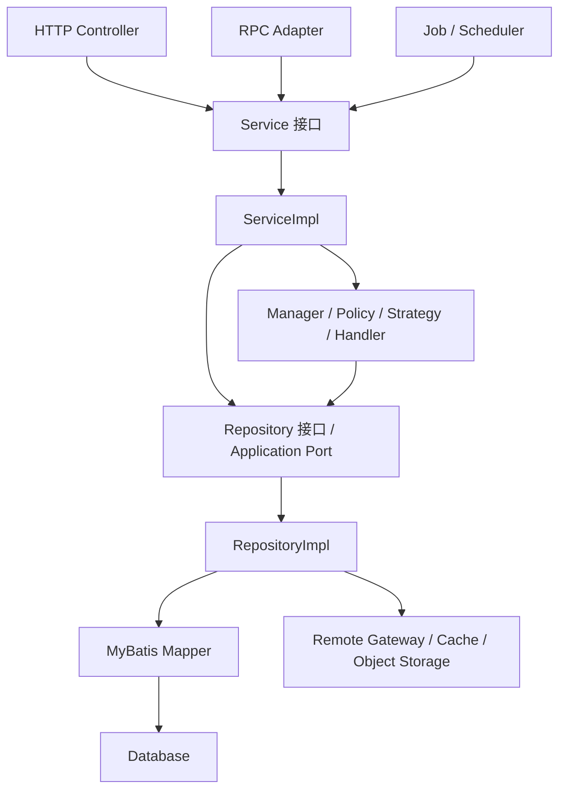

# 后端分层、可读性与业务类型治理重构方案

> 文档状态：待评审
>
> 编制日期：2026-09-08
>
> 最近更新：2026-09-09（补充长期维护、高并发与高性能事务原则）
>
> 适用范围：`feedback-platform/backend`、`feedback-platform/rpc-api` 及其后端测试、配置和数据库脚本
>
> 参考工程：`study-station-server`
>
> 核心目标：在不破坏既有 HTTP、RPC、数据库和异步任务契约的前提下，建立可长期维护的经典分层、全文件关键注释和强业务类型体系。

## 1. 背景

当前后端已经具备 Controller、Service、Repository、Mapper、PO 和部分 application port，但长期迭代后出现了以下结构性问题：

1. 大量业务实现类直接以 `XxxService` 命名，没有对应接口和 `XxxServiceImpl`。
2. Service 目录混有 Worker、Scheduler、Client、Policy、Engine、Assembler、DTO 等不同职责。
3. 部分 Repository 只有具体类，复杂数据访问边界缺少接口；部分既有 Port 与 Repository 职责可能重叠。
4. RPC 实现等入口适配器存在放置在 Service 包中的情况。
5. 很多人工维护文件缺少职责、边界、业务原因及关键约束说明，交接成本高。
6. 状态、动作、类型、等级等业务标量大量使用裸 `String` 或 `Int`，存在拼写错误、非法状态和状态迁移失控风险。
7. 部分大型文件同时承担编排、规则、转换、持久化准备和任务执行，无法通过简单移动目录解决。

截至 2026-09-08 的只读盘点显示：

- `backend/src/main/kotlin/com/feedback/service` 下约有 237 个 Kotlin 文件。
- Service 目录中约有 158 处 `@Service` 注解。
- Service 目录已经存在一批接口和 `fun interface`，说明项目具备接口化基础，但模式尚未统一。
- 已有架构测试禁止 Controller 直连 Repository/Mapper、Service 直连 Mapper、Repository 反向依赖 Service。
- 当前 `code-file-map.md` 仍以备份目录为统计口径，文件数量及路径信息已经过期，需要重建。

上述数字只用于确定重构规模，实施时以每批次自动生成的实时清单为准。

## 2. 参考工程结论

### 2.1 有参考价值的设计

`study-station-server` 的主干设计采用经典单向分层：

```text
Controller / RPC
        ↓
Service 接口
        ↓
ServiceImpl
        ↓
Manager / Repository / DAO
```

其中：

- Service 接口位于 `service`。
- Service 实现位于 `service/impl`。
- Dubbo API 定义和实现分离，RPC 实现是独立入口层。
- 部分复杂 Repository 使用 `Repository -> RepositoryImpl`。
- 简单 Repository 也存在直接使用具体类的情况，Repository 接口化是选择性的。

参考工程当前可确认存在 10 个 `*RepositoryImpl.kt` 文件，例如 `StudentRepositoryImpl`、`AppDurationRepositoryImpl`、`MonitorRepositoryImpl` 和 `ProductBrochureRepositoryImpl`。

### 2.2 不应复制的历史问题

参考工程并非所有实现都符合其架构说明。例如 `StudentRepositoryImpl` 反向依赖内部 `LearningTrendService` 和 `ParentConfigService`，并与上层 Service 形成循环依赖；`@Lazy` 被用于规避其中一部分初始化问题。

该模式不作为本项目参考：

```text
错误：RepositoryImpl → 内部 Service → Repository
正确：ServiceImpl → Repository / 其他 Service
```

如果某个外部 Dubbo 接口名称以 `Service` 结尾，它仍属于外部数据源，应先包装为 `RemoteGateway` 或 `RemoteRepository`，不能与本应用内部 Service 混为一谈。

### 2.3 参考原则

本项目参考的是以下原则，而不是逐行复制参考工程：

- 入口、业务编排、数据访问单向依赖。
- Service 接口与实现分离。
- RPC 实现与内部 Service 分离。
- 复杂 Repository 接口与实现分离。
- 业务域内使用 Manager、Strategy、Handler 承载可复用规则。
- 不复制循环依赖、字段注入、具体实现注入和 Repository 反调 Service 等历史问题。

## 3. 重构目标与非目标

### 3.1 目标

1. 所有真正的业务 Service 形成 `XxxService -> XxxServiceImpl`。
2. Controller、RPC、Job、Scheduler 和跨域调用方只依赖 Service 接口。
3. 复杂 Repository 形成 `XxxRepository -> XxxRepositoryImpl`，简单 Repository 保持适度抽象。
4. 每一个人工维护的后端项目文件具备关键注释，而非只覆盖核心文件。
5. 封闭业务标量使用 Enum、sealed type 或 value object；可变规则进入配置。
6. HTTP、RPC、数据库、消息、任务和前端契约默认保持兼容。
7. 通过自动化架构门禁防止新代码退化。
8. 按业务域小批量迁移，每批可独立验证、回滚和交付。

### 3.2 非目标

- 不在同一批次同时重写全部业务逻辑。
- 不为了接口数量机械地给每个工具类创建空接口。
- 不把所有数字和字符串都改成枚举。
- 不因内部枚举化直接修改数据库历史值或外部协议值。
- 不用大量复述代码的注释掩盖大方法和职责混乱。
- 不照搬参考工程中的循环依赖和历史兼容债务。

## 4. 目标分层



### 4.1 允许的依赖

- Controller、RPC、Job、Scheduler → Service 接口。
- ServiceImpl → Manager、Policy、Strategy、Handler、Repository 接口、Application Port、其他 Service 接口。
- Manager → Repository 接口、领域组件；确有业务编排需要时可依赖窄 Service 接口，但应优先由上层 ServiceImpl 编排。
- RepositoryImpl → Mapper、PO、缓存客户端、远程 Gateway、对象存储客户端。
- Mapper → PO 和数据库参数对象。

### 4.2 禁止的依赖

- Controller/RPC/Job/Scheduler → ServiceImpl。
- Controller → Repository、Mapper、PO。
- ServiceImpl → Mapper。
- Repository/RepositoryImpl → 本应用内部 Service。
- Repository/Mapper → Controller DTO。
- Mapper → Repository 或 Service。
- 领域枚举 → Spring、MyBatis、HTTP 或第三方客户端。
- 任意下层通过 `@Lazy` 规避循环依赖而不治理依赖方向。

## 5. 目标目录

```text
backend/src/main/kotlin/com/feedback/
├── controller/                         # HTTP 入口
├── rpc/                                # Dubbo/RPC 实现入口
├── job/                                # 任务执行入口
├── scheduler/                          # 定时触发器
├── service/
│   ├── alert/                          # Service 接口
│   ├── imports/
│   ├── query/
│   ├── sdk/
│   └── station/
├── service/impl/
│   ├── alert/                          # Service 实现
│   ├── imports/
│   ├── query/
│   ├── sdk/
│   └── station/
├── manager/                            # 领域规则和跨实体协作
├── policy/                             # 判断、授权、状态策略
├── strategy/                           # 可替换算法/策略
├── handler/                            # 单一业务处理器
├── repository/                         # Repository 接口
├── repository/impl/                    # 复杂 Repository 实现
├── repository/remote/                  # 外部 HTTP/RPC 数据源包装
├── mapper/                             # MyBatis Mapper
├── model/
│   ├── command/
│   ├── query/
│   ├── result/
│   ├── enums/
│   ├── value/
│   └── po/
├── dto/                                # HTTP/RPC 边界 DTO
├── convert/                            # 边界与持久化转换
├── config/
└── common/
```

不要求一次性创建所有空目录。目录随业务域迁移逐步落地，但命名和依赖方向从第一批开始固定。

## 6. Service 设计规范

### 6.1 命名和位置

- 接口：`XxxService`，位于 `service/<domain>`。
- 实现：`XxxServiceImpl`，位于 `service/impl/<domain>`。
- 不使用 `IXxxService`。
- `@Service` 和 `@Transactional` 只放在实现类。
- 调用方构造器只声明接口类型。
- 多实现必须使用明确的策略注册或 `@Qualifier`，不得依赖 Bean 名称碰巧匹配。

```kotlin
/**
 * 导入批次业务服务。
 *
 * 负责创建、确认、执行、重试和回滚的业务编排；
 * 不负责文件解析和具体 SQL 操作。
 */
interface ImportBatchService {
    fun confirmMapping(command: ConfirmImportMappingCommand): ImportBatchResult
}
```

```kotlin
/**
 * 导入批次业务服务实现。
 *
 * 数据库事务只覆盖批次、导入行和审计记录；
 * 文件解析与对象存储 I/O 必须在事务外完成。
 */
@Service
class ImportBatchServiceImpl(
    private val importBatchRepository: ImportBatchRepository,
    private val parser: ImportFileParser,
    private val statePolicy: ImportBatchStatePolicy
) : ImportBatchService {
    @Transactional
    override fun confirmMapping(command: ConfirmImportMappingCommand): ImportBatchResult {
        // ...
    }
}
```

### 6.2 接口允许暴露的类型

- Command、Query、Result。
- 业务 DTO/BO/VO。
- 领域枚举和值对象。
- 明确的分页模型。
- 与调用方约定的异常语义。

### 6.3 接口禁止暴露的类型

- MyBatis Mapper。
- 持久化 PO。
- SQL 字段或 QueryWrapper。
- `HttpServletRequest`、`HttpServletResponse`。
- Controller 专用 Request/Response。
- 第三方 SDK Client。
- Repository 内部查询参数。

### 6.4 现有 UseCase 接口处理

项目已有 `SdkIngestService`、`FeedbackListQueryUseCase`、`FeedbackDetailQueryUseCase` 等接口。迁移时先按职责判断：

- 表达完整业务能力的，统一收口为 `XxxService`。
- 仅表达一个窄应用入口、读端口或授权端口的，可保留 `XxxUseCase`/`XxxPort`。
- 禁止为同一能力同时保留 `XxxService`、`XxxUseCase` 和 `XxxOperations` 三套等价接口。
- 任何命名调整必须同步实现类、注入点、测试 Mock 和文档。

## 7. Repository 设计规范

### 7.1 选择性接口化

Repository 不执行“全部机械接口化”。满足以下任一条件时必须抽接口：

- 聚合多个 Mapper 或多个数据源。
- 包含锁、CAS、租约、原子状态迁移。
- 同时访问 MySQL、Redis、ES、Milvus、对象存储或远程系统。
- 被多个 Service/Manager 复用。
- 需要稳定 Mock 或替换实现。
- 已有/计划存在多实现、影子实现或迁移实现。
- 对上层提供明确的数据一致性或领域查询语义。

简单、单 Mapper、无独立业务语义的薄封装可以暂时保留具体 Repository，但仍必须遵守下层不反调 Service、上层不直连 Mapper的规则。

### 7.2 命名和位置

- 接口：`XxxRepository`，位于 `repository/<domain>`。
- 实现：`XxxRepositoryImpl`，位于 `repository/impl/<domain>`。
- `@Repository` 只标注实现类或无需接口的具体 Repository。
- Repository 接口不暴露 Mapper、PO 或 MyBatis 类型。
- RepositoryImpl 负责领域类型与 PO/数据库标量之间的转换。

```kotlin
/**
 * 导入批次数据边界。
 *
 * `transition` 使用期望版本进行原子迁移，返回 false 表示并发冲突。
 */
interface ImportBatchRepository {
    fun findById(id: Long): ImportBatch?

    fun transition(
        id: Long,
        expectedVersion: Long,
        target: ImportBatchStatus
    ): Boolean
}
```

### 7.3 与 application/port 的关系

`application/port` 与 Repository 接口不能表达同一能力。实施时逐个判断：

- 已有 Port 已完整表达 ServiceImpl 所需能力：RepositoryImpl 直接实现该 Port，不再新建 Repository 接口。
- Port 是跨模块应用契约，Repository 是数据聚合边界：可以两者并存，但必须职责不同。
- 仅因历史命名造成重复：选择一个保留，迁移调用方后删除另一个。

目标是稳定依赖边界，而不是增加接口数量。

### 7.4 远程系统

外部 Dubbo/HTTP 接口统一包装：

```text
ServiceImpl
    ↓
StudentRemoteGateway
    ↓
外部 UserApiService / StudentApiService
```

外部接口即使以 `Service` 结尾，也不得直接散落在内部 RepositoryImpl 和 ServiceImpl 中。Gateway 注释必须说明外部系统、超时、重试、幂等和降级约束。

## 8. 全文件关键注释治理

### 8.1 覆盖范围

注释治理覆盖每一个人工维护的后端项目文件，不只覆盖核心代码：

- 生产 Kotlin/Java。
- 单元测试、架构测试、集成测试及专项测试。
- MyBatis XML。
- Flyway SQL。
- YAML、properties、Gradle Kotlin DSL。
- RPC API 和 DTO。
- 后端脚本。

仅排除：

- `build/`、`target/` 和运行时输出。
- 自动生成代码。
- 二进制文件。
- 第三方源码。
- 缓存、IDE 和构建产物。

### 8.2 每个文件必须回答的问题

每个文件至少通过文件说明或主类型 KDoc/Javadoc回答：

1. 这个文件负责什么？
2. 它在调用链中的位置是什么？
3. 它不负责什么，或有什么不能轻易改变的约束？

一个文件有多个公开类型时，每个公开类型都必须有注释；同时应评估拆为一类型一文件。

### 8.3 各类型最低要求

| 文件类型 | 必须说明的关键内容 |
|---|---|
| Controller | 对外入口、用例、鉴权、版本兼容和输入边界 |
| Service 接口 | 业务职责、调用方、不变量、幂等/事务要求 |
| ServiceImpl | 编排流程、事务边界、关键副作用和失败策略 |
| Manager/Policy/Strategy | 封装规则、适用范围、输入输出和扩展方式 |
| Repository 接口 | 数据能力、数据源语义、一致性、锁/CAS语义 |
| RepositoryImpl | Mapper/缓存/远程依赖、原子性和转换边界 |
| Mapper | 对应表、SQL职责、锁、分页、批处理注意事项 |
| PO | 对应表、记录含义、特殊字段及历史兼容值 |
| DTO/VO/Command/Query | 使用方向、所属接口、版本和敏感字段 |
| Enum/Value Object | 业务含义、协议/持久化值、非法值策略 |
| Config | 配置用途、默认值、生产要求和修改风险 |
| Job/Scheduler/Worker | 触发方式、并发、租约、幂等、重试和补偿 |
| Exception | 触发条件、错误码和调用方可见语义 |
| Converter/Assembler | 转换方向、字段丢失、脱敏和默认值规则 |
| Test | 业务场景、前置条件和重点风险 |
| MyBatis XML | Mapper职责；复杂 SQL 的数据口径、锁和性能约束 |
| Flyway SQL | 变更目的、兼容策略、历史数据和不可逆点 |
| Gradle/YAML/脚本 | 非显而易见的任务、依赖、环境边界和安全要求 |

其中，`ServiceImpl`、`RepositoryImpl`、远程 Gateway 及承担主体装配的安全实现必须同时满足方法级约束：

- 每个公开实现方法必须有紧邻方法（可隔注解）的 KDoc/Javadoc，说明接口语义在该实现中的事务、
  锁/CAS、幂等、缓存、外部 I/O、批量策略或失败策略；类注释和接口方法注释不能替代实现方法注释。
- 承担上述关键逻辑的私有/内部方法同样必须有紧邻注释；简单转换方法也应说明转换方向、丢失信息或不变量。
- 注释必须描述实现选择和“为什么”，不能只复述方法名。重构修改实现语义时必须同步更新方法注释。

对已宣布完成迁移的业务链，方法级验收范围必须按调用链目录递归确定，不得只按 `Impl`
文件名抽样。Service/Repository 接口、Mapper、Controller、Filter、安全组件、值对象边界
方法与关键私有函数同样要有紧邻 KDoc/Javadoc；方法与注解必须分行，禁止将
`if (...) throw/return/require/...` 或 `else ...` 执行体压缩在同一行。这些格式要求是为了
让异常语义、锁顺序和失败关闭分支能被审查，不以“代码较短”为豁免理由。

### 8.4 强制注释的逻辑

以下逻辑无论是否公开都必须说明“为什么”：

- 事务范围和事务外 I/O。
- 分布式锁、行锁、乐观锁、CAS、租约。
- 幂等键生成和冲突处理。
- 状态迁移和终态判断。
- 重试、补偿、死信和重放。
- 降级、熔断、影子执行、双写。
- 权限、脱敏、审计和敏感数据处理。
- 旧版本或旧数据兼容。
- 容易被误删的性能优化和批量策略。

兼容注释必须给出删除条件；无法确认业务来源时不得编造，可使用带问题编号的待确认注释。

### 8.5 禁止的低价值注释

- 逐行翻译代码。
- “获取列表”“判断是否为空”等无新增信息的注释。
- 与实现不一致的历史说明。
- 没有原因、负责人、问题编号或完成条件的长期 TODO。
- 使用注释掩盖超长方法、重复分支和错误职责。

### 8.6 文件职责地图

全文件注释与 `code-file-map.md` 是两项独立交付：

- 文件内注释服务于阅读单个文件。
- 文件职责地图服务于跨模块导航、交接和影响分析。

迁移完成后必须从当前源码重新生成并人工校验文件职责地图，不得继续引用备份目录或过期统计。

## 9. 业务标量、枚举和值对象治理

### 9.1 分类原则

不是所有标量都改成枚举，按语义分类：

| 值类型 | 推荐表达 |
|---|---|
| 封闭且稳定的状态、类型、动作、等级 | Enum / sealed type |
| 有格式和校验规则的 ID、版本、哈希、业务键 | Value Object |
| 可动态调整的阈值、窗口、次数、比例、开关 | 类型化配置或配置表 |
| 协议头、固定前缀、正则、技术限制 | 有命名的常量 |
| 纯二元判断 | Boolean；存在未知/待定时使用枚举 |
| 外部开放集合 | String + 严格边界解析/白名单，不假设永久封闭 |

### 9.2 必须枚举化的典型字段

- 批次、任务、处理、审核、发布和通知状态。
- 导入方式、渠道、来源类型、附件类型。
- 确认、拒绝、关闭、重试等动作。
- 风险、严重度、优先级和审核等级。
- 成功、失败、待复核等业务结果。
- 状态机中的源状态和目标状态。

```kotlin
/**
 * 导入批次生命周期状态。
 *
 * [code] 与数据库及既有 HTTP 响应保持一致；禁止使用展示文案持久化。
 */
enum class ImportBatchStatus(val code: String) {
    AWAITING_MAPPING("AWAITING_MAPPING"),
    PROCESSING("PROCESSING"),
    COMPLETED("COMPLETED"),
    PARTIAL_SUCCESS("PARTIAL_SUCCESS"),
    FAILED("FAILED");

    companion object {
        fun fromCode(code: String): ImportBatchStatus =
            entries.firstOrNull { it.code == code }
                ?: throw IllegalArgumentException("Unsupported import batch status: $code")
    }
}
```

### 9.3 可配置值不得枚举化

以下内容进入 `@ConfigurationProperties` 或运行时配置表：

- 回滚窗口。
- 重试次数和退避时间。
- 文件大小及分片大小。
- 风险分数和告警阈值。
- 超时时间、租约时长、灰度比例。
- 可运营调整的渠道或白名单。

配置必须有类型、单位、默认值说明、上下界校验和生产环境要求。

### 9.4 状态机

枚举只解决合法取值；状态迁移必须由枚举能力或独立 Policy 控制：

```kotlin
class ImportBatchStatePolicy {
    fun requireTransition(
        current: ImportBatchStatus,
        target: ImportBatchStatus,
        context: ImportBatchContext
    ) {
        // 权限、版本、对账和终态约束集中在这里校验。
    }
}
```

禁止在多个 Service 中分别维护 `setOf("PENDING", "FAILED")` 等字符串集合。

### 9.5 边界兼容

第一阶段保持外部标量不变：

```text
HTTP/RPC String
      ↓ Controller/RPC Adapter 解析
业务 Enum / Value Object
      ↓ Service/Manager
业务 Enum / Value Object
      ↓ RepositoryImpl 转换
数据库 String/Int
```

- Controller/RPC 负责外部值解析和错误响应。
- Service 只处理强业务类型。
- RepositoryImpl 负责领域类型与 PO 标量转换。
- 数据库既有编码默认不变。
- HTTP/RPC 响应默认保持原有 code。
- 未知外部值采用显式拒绝或 `UNKNOWN`，不得静默映射为正常状态。
- 是否允许 `UNKNOWN` 必须按协议的前向兼容要求逐项决定。

## 10. 文件与职责归位规则

重构时先判断职责，再决定是否抽接口：

| 当前名称/职责 | 目标位置 |
|---|---|
| 业务用例入口 | `service/<domain>/XxxService` |
| 业务用例实现 | `service/impl/<domain>/XxxServiceImpl` |
| 领域聚合规则 | `manager/<domain>` |
| 状态/权限/发布策略 | `policy/<domain>` |
| 可替换算法 | `strategy/<domain>` |
| 单一处理步骤 | `handler/<domain>` |
| 后台执行单元 | `job` 或 `worker` |
| 定时触发器 | `scheduler` |
| 外部 HTTP/Dubbo 客户端 | `repository/remote` 或 `gateway` |
| RPC 服务实现 | `rpc/<domain>` |
| 响应/命令/查询模型 | `dto` 或 `model/*` |
| 持久化记录 | `model/po/<domain>` |
| 对象转换 | `convert/<domain>` |

`FeedbackPlatformRpcApiImpl` 等 RPC 实现必须从 Service 包迁到 `rpc`，并只依赖内部 Service 接口。

## 11. 接口方法变更策略

### 11.1 默认原则

- 结构迁移批次默认不改变业务行为。
- 内部接口调整与 HTTP/RPC 契约调整分开提交。
- 方法参数超过合理数量时优先改为 Command/Query。
- 返回 `Map<String, Any?>` 的业务接口逐步改为明确 Result 类型。
- 方法名必须表达业务动作，不暴露表结构和 SQL 操作。

### 11.2 影响链

Service 方法变化必须同步检查：

```text
Service 接口
→ ServiceImpl
→ 其他 Service/Manager
→ Controller/RPC/Job/Scheduler
→ Spring 配置
→ 单元测试/Mock
→ 集成测试
→ OpenAPI/RPC API
→ SDK/前端/外部消费者
```

### 11.3 外部兼容

- 仅内部签名变化：编译期完成所有调用方迁移。
- HTTP DTO 变化：必须更新 OpenAPI、前端和契约测试。
- RPC 方法/DTO 变化：优先新增 V2，保留旧方法兼容期，不原地破坏消费者。
- 数据库值变化：必须提供 Flyway、双读/双写或回填方案，不通过枚举重命名隐式完成。
- MQ/任务载荷变化：必须携带 schema/version 并提供旧载荷解析路径。

## 12. 超大文件治理

以下类型不能只做接口提取和改名：

- 同时包含多个 Spring Bean。
- 同时包含 DTO、Worker、Scheduler、Service 和辅助对象。
- 单文件数百行且跨越多个事务或状态机。
- 一个方法同时完成校验、查询、转换、写库、远程调用和审计。

以导入域为例：

```text
ImportBatchServiceImpl              # 用例与事务编排
├── ImportFileParser                # 文件解析
├── ImportMappingManager            # 字段映射
├── ImportBatchStatePolicy          # 状态迁移
├── ImportReconciliationManager     # 对账
├── ImportRollbackManager           # 回滚规则
└── ImportBatchRepository           # 数据边界
```

拆分约束：

- 每次拆分先由测试冻结行为。
- 不以行数作为唯一标准，以职责和变化原因作为边界。
- 新组件必须有明确输入输出，不共享可变全局状态。
- 事务入口保持在 ServiceImpl，除非 RepositoryImpl 实现明确的原子数据操作。
- 文件 I/O 和远程调用避免被无意纳入长事务。

### 12.1 长期维护、高并发与高性能事务原则

事务边界必须由“本地数据库一致性单元”决定，不得用单表或多表作为是否加事务的判断条件：

1. 一个本地业务阶段内存在相互依赖的多次数据库交互，包括多次查询、多次更新或查询后更新时，必须使用事务保证一致性。
2. 一个阶段只有一条原子 SQL，且没有依赖前置数据库读取结果的业务判断时，不额外声明事务，使用 InnoDB 自动提交。
3. 一次客户端请求不等于只能有一个数据库事务。请求包含远程 HTTP、Redis、文件/对象存储、消息发送或高成本计算时，应按一致性阶段拆成多个短事务。
4. BCrypt、加解密、压缩、文件解析、大对象序列化和复杂规则计算等高成本 CPU 操作原则上在事务外执行，避免长时间占用数据库连接。
5. 多次相关查询需要同一视图时使用短 `readOnly` 事务；读取完成后立即释放数据库连接，不把后续纯计算纳入事务。
6. 查询与写入之间存在事务外计算时，写阶段必须通过 `version`、CAS、条件 UPDATE、唯一键或必要的行锁重新确认读取快照仍有效，不能直接提交旧快照。
7. 多次相关写入以及必须与业务状态共同成功的审计/outbox 写入，应放入独立短写事务，共同提交或回滚。
8. 数据库事务不得跨越远程 HTTP、Redis、文件/对象存储或消息发送；需要跨资源一致性时使用 outbox、幂等、补偿或明确的分段状态机。
9. 并发冲突重试必须有明确上限，只重试幂等或可安全重放的阶段；不得在事务中无界重试，也不得把状态冲突误记为密码错误等业务失败。
10. `@Transactional` 优先放在可由 Spring 代理调用的 `ServiceImpl` 公共方法；已加入上层事务的 Repository 方法不重复声明。RepositoryImpl 仅在自身实现完整原子数据操作时拥有事务。
11. “至少保留一个管理员”等跨行不变量不能只依赖事务内计数；所有可能改变该集合的写路径必须共享同一锁/CAS 栅栏，并采用固定锁顺序，防止写偏差和死锁。
12. 权限包等可能影响大量用户的变更必须优先使用数据库集合式条件更新，不得把无界用户 ID 回拉 JVM、拼接巨大 `IN` 或拆成会暴露中间权限状态的分批提交。
13. 事务门禁不能只检查 `@Transactional` 是否存在，还必须冻结外部 I/O/复杂计算位于事务外、锁获取顺序、集合查询上限及集合式更新形态；高风险并发不变量应补真实数据库合同测试。

推荐的在线高成本认证/校验模板：

```text
短只读事务：批量读取一致业务快照
        ↓ 立即释放连接
事务外：BCrypt / 加解密 / 复杂计算 / 远程 I/O
        ↓
短写事务：版本条件更新（CAS）+ 审计/outbox
        ↓ 提交后
Redis / Cookie / 消息发布等外部副作用
```

性能验收不能只看方法耗时，还必须检查：事务持有连接时长、事务内 SQL 数量、锁等待、连接池占用、
重复查询、N+1、冲突重试次数及外部 I/O 是否误入事务。代码注释必须说明事务包含哪些数据库交互、
哪些操作明确位于事务外，以及并发快照失效时如何处理。

## 13. 实施阶段

### 阶段 0：基线、清单与规则冻结

交付物：

1. 实时文件清单：路径、领域、职责、主类型、调用方、注释状态、魔法值、目标位置。
2. REST 路由和请求/响应快照。
3. RPC API、DTO 和版本快照。
4. 数据库状态码、类型码和配置项字典。
5. Job/Scheduler、幂等键、锁、租约和事务清单。
6. 当前测试及构建结果。
7. 参考工程采用项和明确不采用项的 ADR。

本阶段只记录现状，不改变业务行为。

### 阶段 1：全文件关键注释补齐

按业务域逐文件执行：

1. 补文件或主类型职责说明。
2. 补所有公开类型说明。
3. 补 Service/Repository 公开方法业务语义。
4. 补所有 Impl 公开方法及关键私有方法的紧邻实现注释；不得用类注释或接口注释替代。
5. 补事务、锁、幂等、状态机、重试、补偿、隐私和兼容原因。
6. 拆分一个文件中的多个无关公开类型。
7. 对无法确认的历史行为登记待确认项，不编造解释。
8. 更新文件职责地图。

验收：范围内所有人工维护文件均有关键注释，无“核心文件例外”或“简单文件例外”。

### 阶段 2：业务标量和配置治理

1. 建立领域状态/类型/动作字典。
2. 合并同义值，确认历史拼写和外部编码。
3. 为封闭集合建立 Enum/sealed type。
4. 为业务键、版本、哈希等建立必要的 value object。
5. 将阈值、时间窗、次数和开关迁入类型化配置。
6. Controller/RPC 和 RepositoryImpl 建立边界转换。
7. 增加枚举解析、序列化、数据库映射和状态迁移测试。

本阶段默认不改变外部字符串、数据库编码及响应格式。

### 阶段 3：架构门禁先行

扩展独立 `architectureTest`：

- Controller/RPC/Job/Scheduler 不得依赖 `service.impl`。
- ServiceImpl 必须以 `ServiceImpl` 结尾并实现接口。
- Service 接口不得标注 `@Service`、`@Transactional`。
- ServiceImpl 不得直接依赖 Mapper。
- RepositoryImpl 不得依赖内部 Service。
- RPC 实现只能位于 `rpc`。
- 公开 Service/Repository 类型必须有 KDoc/Javadoc。
- 已迁移域的 ServiceImpl、RepositoryImpl、Gateway 和安全实现中，每个方法必须有紧邻 KDoc/Javadoc。
- 已迁移域按完整调用链目录扫描所有命名函数，不得只扫描 Impl；注解与函数、条件与执行体不得同行压缩。
- 新增业务状态裸字符串违反已登记的领域字典时失败。
- Mapper Kotlin/XML namespace 和类型绑定继续由现有门禁覆盖。

门禁先支持迁移白名单，白名单必须注明责任域、原因和到期时间；每批迁移后删除对应条目。

已迁移域的交付必须使用同一验收矩阵同时复查分层依赖、方法注释、业务裸值、
事务边界、锁/CAS 顺序、幂等与重试、SQL 可读性及有界性。修改其中一项后仍必须运行整张
矩阵，不得以定向搜索替代其他维度的回归。

### 阶段 4：已有接口模式收口

优先处理已经有接口的模块，降低第一批风险：

- SDK ingest/attachment/telemetry operations。
- feedback detail/list/attachment use cases。
- 已有 storage、gateway、policy 接口。

动作包括：

- 决定保留 `Service`、`UseCase`、`Port` 或 `Operations` 中的唯一语义接口。
- 实现迁入 `service/impl/<domain>`。
- 实现类统一 `Impl` 后缀。
- 更新构造器注入、测试和 Mock。

### 阶段 5：查询和只读域迁移

建议顺序：

1. query/detail/listprojection。
2. report 查询。
3. admin/applicationidentity 查询。
4. knowledge 查询。

查询域副作用较少，用于验证目录、命名、注释和枚举规范是否可持续。

### 阶段 6：核心写入域迁移

建议逐域执行：

1. auth。
2. attachment。
3. station。
4. sdk。
5. imports。
6. masking。

每个域单独评审事务、I/O、幂等、锁、回滚和外部契约。

### 阶段 7：异步和复杂计算域迁移

建议顺序：

1. jira。
2. alert。
3. ai。
4. cluster。
5. sync。

同步完成 Worker、Scheduler、Engine、Strategy、Manager、远程 Gateway 的职责归位，避免只做表面接口化。

### 阶段 8：收尾与债务删除

- 删除旧类名、旧包和临时 Bean alias。
- 删除所有已完成迁移的白名单。
- 删除重复 Port/Repository/UseCase。
- 重新生成并校验文件职责地图。
- 更新技术架构、README 和开发规范。
- 输出最终依赖图、接口清单、枚举字典和例外清单。

## 14. 单个业务域标准迁移流程

每个业务域使用同一检查表：

1. 生成域内文件和依赖清单。
2. 确认所有文件关键注释完整。
3. 盘点裸状态、类型、动作、阈值和常量。
4. 冻结现有行为和外部契约。
5. 区分 Service、Manager、Policy、Worker、Client、DTO 等职责。
6. 建立或收口 Service 接口。
7. 将实现改名并迁入 `service/impl`。
8. 评估 Repository 是否需要接口化。
9. 建立边界枚举/值对象转换。
10. 更新所有构造器注入、Spring 配置和 Mock。
11. 执行域内单元测试。
12. 执行架构测试。
13. 执行完整后端测试和打包。
14. 涉及外部契约时执行前端、SDK、RPC 消费者验证。
15. 更新文件职责地图和变更记录。

每个步骤都完成后才能进入下一个业务域。

## 15. 提交和评审策略

### 15.1 提交拆分

推荐提交顺序：

1. 行为测试和契约快照。
2. 注释及职责说明，不改逻辑。
3. Enum/value object/config 引入及边界转换。
4. Service 接口和实现迁移。
5. Repository 接口和实现迁移。
6. 大文件职责拆分。
7. 架构门禁和文档更新。

避免在一个提交中同时出现大规模移动、方法改名、状态码变化和业务逻辑修改。

### 15.2 评审视角

每个 PR 必须回答：

- 这个批次覆盖哪些文件和业务链路？
- 入口契约、数据库编码和任务载荷是否变化？
- Service/Repository 依赖方向是否正确？
- 所有文件是否有关键注释？
- 哪些裸标量被类型化，哪些被配置化？
- 事务、锁、幂等和重试是否保持？
- 如何验证、如何回滚？
- 是否新增临时白名单，何时删除？

## 16. 测试与验证

### 16.1 每批必跑

```bash
./gradlew :backend:architectureTest
./gradlew :backend:test
./gradlew :backend:bootJar
```

根据业务域追加：

- `:backend:integrationTest`
- `:backend:realIndexTest`
- `:backend:clusterShadowTest`
- SDK 测试与 Demo 构建
- 前端测试和类型检查
- RPC provider/consumer 契约测试

### 16.2 重点测试

- Spring Context 能否启动且无多 Bean 歧义。
- `@Transactional` 是否仍作用于代理入口。
- 内部自调用是否绕过事务代理。
- 高成本 CPU、远程 HTTP、Redis、文件和消息 I/O 是否位于数据库事务外。
- 多次相关读取是否使用短只读事务，事务外计算后的写入是否使用版本/CAS 重新确认快照。
- 并发冲突重试是否有上限，是否避免把状态冲突记录成业务凭据失败。
- Enum 与数据库/JSON/RPC code 的双向转换。
- 未知、空白、大小写异常状态值。
- 状态迁移合法与非法路径。
- 幂等冲突、重试、补偿、死信和回放。
- 锁/CAS/租约并发竞争。
- 双写、影子执行和降级路径。
- 历史数据库值及旧版本请求兼容。
- 安全、脱敏、权限和审计行为。

## 17. 回滚策略

### 17.1 结构重构

结构迁移不改变数据，可通过回退单个业务域提交恢复。禁止多个业务域共享一个不可拆分提交。

### 17.2 Spring Bean 迁移

确需兼容旧 Bean 名称时可短期提供显式 alias，但必须：

- 标记用途和删除日期。
- 不同时暴露两个默认实现。
- 不让新代码继续依赖旧名称。

### 17.3 枚举和协议

- 内部 Enum 保持原始 `code`，回滚不需要数据迁移。
- 新增状态不得在旧版本无法识别时提前落库。
- 必须改变数据库编码时使用独立 Flyway 和回填方案。
- RPC/消息升级使用版本化载荷，旧消费者在兼容期内可继续工作。

### 17.4 大文件拆分

拆分前后使用特征测试、状态机测试和契约快照对比；出现差异时先回退结构变化，不在迁移 PR 中临时修改业务规则。

## 18. 风险与控制措施

| 风险 | 表现 | 控制措施 |
|---|---|---|
| Spring 注入歧义 | 接口出现多个实现 | 单默认实现；多实现显式策略/Qualifier；Context 测试 |
| 事务失效 | 注解移动或类内自调用 | 事务测试；事务入口放 ServiceImpl 公共方法 |
| 循环依赖 | Repository 反调 Service | 架构门禁；编排上移；禁止用 `@Lazy` 掩盖 |
| 契约破坏 | DTO/枚举序列化变化 | 边界转换；OpenAPI/RPC 快照；V2 兼容 |
| 历史数据无法解析 | 数据库存在未知状态 | 迁移前数据盘点；显式 UNKNOWN/异常策略 |
| 注释失真 | 注释与代码不同步 | 注释与代码同 PR；评审业务原因；避免复述代码 |
| 接口爆炸 | 每个类机械抽接口 | 只为业务边界和复杂 Repository 抽象 |
| PR 过大 | 移动、改名、逻辑混杂 | 单域、单目标提交；先测试后迁移 |
| 配置错误 | 魔法数字迁移后缺省不一致 | 类型化配置、范围校验、启动检查和默认值测试 |
| 性能回退 | 长事务执行 BCrypt/远程 I/O、连接池占用、拆分后重复查询 | 事务耗时与 SQL/调用次数基线；短读/短写事务；CAS；批处理与缓存行为测试 |

## 19. 架构门禁设计

建议在现有 `architectureTest` 基础上增加以下测试类：

```text
ServiceImplementationArchitectureTest
RepositoryBoundaryArchitectureTest
SourceDocumentationArchitectureTest
BusinessScalarArchitectureTest
RpcBoundaryArchitectureTest
```

### 19.1 ServiceImplementationArchitectureTest

- `service/impl` 中 Spring Service 名称必须以 `ServiceImpl` 结尾。
- 每个 ServiceImpl 必须实现至少一个业务接口。
- Service 接口不得依赖 `service.impl`。
- 入口层不得 import `service.impl`。

### 19.2 RepositoryBoundaryArchitectureTest

- RepositoryImpl 不得 import 内部 Service。
- ServiceImpl 不得 import Mapper。
- Repository 接口不得引用 PO/MyBatis 类型。
- Mapper 不得引用 Repository/Service。

### 19.3 SourceDocumentationArchitectureTest

- 所有人工维护源码文件有文件职责或主类型说明。
- 所有公开类型有 KDoc/Javadoc。
- Service/Repository 公开方法有业务语义说明。
- 已迁移域的 Impl 公开方法及关键私有方法有紧邻实现说明；类/接口注释不作为替代。
- 门禁按已迁移实现目录递归扫描，新文件自动纳入；迁移新业务域时必须登记其实现目录。
- 例外只能通过带原因和到期时间的白名单登记。

该门禁检查“是否存在关键说明”，代码评审负责判断说明质量，不能依靠注释行数或覆盖率替代人工判断。

### 19.4 BusinessScalarArchitectureTest

- 对已完成治理的字段禁止重新引入裸状态字符串。
- 禁止在 Service 中新增已登记状态的 `setOf("...")`。
- 可变阈值不得新增为散落魔法数字。
- HTTP 状态码、数组索引、数学常数等使用合理白名单，避免误报。

## 20. 验收标准

### 20.1 分层

- 所有业务 Service 都有接口和 `ServiceImpl`。
- Controller、RPC、Job、Scheduler 对 `service.impl` 的依赖为 0。
- Service 对 Mapper 的直接依赖为 0。
- RepositoryImpl 对内部 Service 的依赖为 0。
- RPC 实现全部位于 `rpc`。
- 没有通过 `@Lazy` 掩盖的分层循环依赖。

### 20.2 可读性

- 每一个人工维护的后端文件都有关键注释。
- 每个公开类型都有职责和边界说明。
- 每个已迁移 Impl 的公开方法和关键私有方法都有紧邻、非复述式的实现说明。
- 锁、事务、幂等、重试、补偿、兼容、安全逻辑都有原因说明。
- 文件职责地图以当前源码为基准且可用于影响分析。
- 不存在用无意义注释凑覆盖率的做法。

### 20.3 业务类型

- 已登记的业务状态、动作、类型和等级不再以裸标量在 Service 中传播。
- 状态迁移集中管理并有测试。
- 可变阈值进入类型化配置。
- HTTP/RPC/数据库既有 code 在未声明变更时保持一致。
- 未知值处理策略明确，不静默回退。

### 20.4 构建与契约

- `:backend:architectureTest` 通过。
- `:backend:test` 通过。
- `:backend:bootJar` 通过。
- 受影响的集成、索引、影子、SDK、前端和 RPC 测试通过。
- REST、RPC、数据库和任务契约无未声明差异。
- 所有临时白名单和兼容 alias 有负责人、原因和删除日期。
- 高成本 CPU 与外部 I/O 不占用数据库事务；多次相关查询、短写提交和并发重试符合 12.1 节原则。

## 21. 最终交付物

1. 本重构方案及评审记录。
2. 当前后端文件和依赖清单。
3. 全文件关键注释覆盖清单。
4. 更新后的代码文件职责地图。
5. Service 接口与实现清单。
6. Repository 接口化决策清单。
7. 业务枚举、值对象和配置字典。
8. 状态机和事务边界清单。
9. HTTP/RPC/消息/任务契约快照。
10. 架构门禁及例外白名单。
11. 各业务域测试证据。
12. 迁移、兼容和回滚记录。

## 22. 推荐决策摘要

本次重构统一采用以下决策：

```text
Service：全面接口化，严格 Service → ServiceImpl
Repository：按复杂度选择性 Repository → RepositoryImpl
依赖方向：入口 → Service → ServiceImpl → Manager/Repository → Mapper/Remote
注释范围：每一个人工维护的后端项目文件，无简单文件例外
业务标量：封闭业务集合类型化，可变规则配置化
兼容原则：内部强类型，边界转换，默认不改变外部和数据库 code
事务原则：按本地一致性阶段划分短事务，高成本计算与外部 I/O 在事务外，写入用版本/CAS 防止旧快照
实施方式：先基线和注释，再标量治理，再逐业务域迁移，最后删除债务
```

该方案的完成标准不是目录看起来整齐，而是新开发人员能够从任意文件理解职责和约束，编译器能够阻止非法业务值，架构测试能够阻止跨层依赖，且每个业务域都能独立演进、测试和交付。
