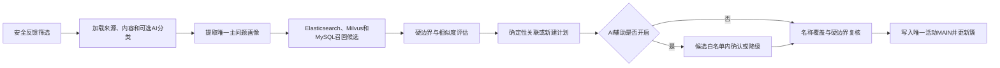

# 反馈问题簇归类：现有代码流程唯一事实说明

## 审阅结论

| 审阅项     | 结论                                                                      |
| ---------- | ------------------------------------------------------------------------- |
| 审阅对象   | 反馈从安全资格筛选到唯一活动`MAIN` 关联落库的完整归簇链路。               |
| 代码基线   | 2026-08-28 当前工作树；工作树包含未提交改动。                             |
| 权威边界   | 本文件是流程汇总入口；代码、Flyway和实际运行时配置仍是最终权威。          |

审阅时需要直接确认的代码事实如下：

1. 当前归簇是逐条反馈的在线归属判断，不是DBSCAN、K-Means或TF-IDF批量聚类。
2. 一条安全反馈最终只保留一个活动 `MAIN`；边界不清的 `CANDIDATE` 会由引擎转为保守新建。
3. 确定性文本相似度是字符二元组Dice与LCS包含分数取最大值；Milvus余弦只用于向量候选证据。
4. 明显乱码、极短或低信息反馈不会从归簇队列删除，而会规范化后继续关联低信息簇或新建簇。
5. 不同应用没有按 `application_id` 强制隔离或直接加权；相同 `appVersion` 只影响候选排序分。
6. AI开启时只能确认确定性候选或将其降级为新建，不能把程序判定的新建或歧义结果升级为自动关联。

## 流程总览

## 1. 实现位置

- 归簇入口位于 `backend/src/main/kotlin/com/feedback/service/cluster/`。
- Elasticsearch、向量嵌入、Milvus和RRF候选召回位于 `backend/src/main/kotlin/com/feedback/service/sync/`。
- 融合之后的候选重排（端口、守卫、恒等实现）同在 `.../service/sync/`；生产实现与它依赖的
  候选正文端口在 `.../service/cluster/`（需要簇域正文与脱敏规则），开关在 `.../config/RerankProperties.kt`。
- 未找到使用DBSCAN或TF-IDF执行问题簇归类的代码。
- 当前流程不是对整批反馈执行无监督聚类，而是逐条执行“候选召回、边界判断、关联已有簇或新建簇”。

## 2. 逐步骤输入、处理与输出

| 步骤编号 | 入口方法（类名.方法名）                                                                                                                                | 输入数据结构（字段名+类型+样例）                                                                                                                                                                                                                                                                                                                                | 处理逻辑简述（只写做了什么，不写为什么）                                                                                                                                                                                                                                                                                                                                                                                                                                                                                                                                                                                                                                  | 输出数据结构（字段名+类型+样例）                                                                                                                                                                                                                                                                                                                                                                                                                                                            | 该步骤是否涉及 application_id 筛选或噪声过滤？如果是，请描述具体过滤条件。                                                                                                                                                                                                                                                                                                                                                                            |
| -------- | ------------------------------------------------------------------------------------------------------------------------------------------------------ | --------------------------------------------------------------------------------------------------------------------------------------------------------------------------------------------------------------------------------------------------------------------------------------------------------------------------------------------------------------- | ------------------------------------------------------------------------------------------------------------------------------------------------------------------------------------------------------------------------------------------------------------------------------------------------------------------------------------------------------------------------------------------------------------------------------------------------------------------------------------------------------------------------------------------------------------------------------------------------------------------------------------------------------------------------- | ------------------------------------------------------------------------------------------------------------------------------------------------------------------------------------------------------------------------------------------------------------------------------------------------------------------------------------------------------------------------------------------------------------------------------------------------------------------------------------------- | ----------------------------------------------------------------------------------------------------------------------------------------------------------------------------------------------------------------------------------------------------------------------------------------------------------------------------------------------------------------------------------------------------------------------------------------------------- |
| 1        | `ClusteringScheduler.clusterReadyRecords`；全量入口为 `ClusterReclassificationController.start` → `ClusterReclassificationService.start/processBatch` | 普通调度从数据库读取：`source_id: Long=12345`、`masking_status: String="PASS"`、`is_deleted: Boolean=false`、活动关联 `cluster_link.id: Long?=null`。全量入口另接收 `requestId: UUID`、`reason: String`、`userId: Long`。                                                                                                                                       | 普通调度按`created_at,source_id` 查询最多100条尚无活动 `MAIN` 的反馈并逐条调用 `ClusteringEngine.cluster`。AI辅助开启时排除仍有 `PENDING`、`RETRY_PENDING` 或租约有效 `PROCESSING` AI任务的反馈。全量重分类先停用旧 `MAIN/CANDIDATE`、归档旧候选簇，再由专用线程每批处理100条。实际工具：Spring `@Scheduled`、JDBC、Spring事务、JPA。                                                                                                                                                                                                                                                                                                                                     | 普通入口产生`List`，如 `[12345,12346]`，随后逐条产生 `ClusterDecision?`。全量入口产生 `ClusterReclassificationView`，如 `id: Long=8`、`runStatus: String="RUNNING"`、`snapshotSafeCount: Long=25981`。                                                                                                                                                                                                                                                                                | 不按`application_id` 筛选。资格条件为 `masking_status='PASS'`、`is_deleted=false`、没有活动 `MAIN`。不检查文本长度、乱码或描述质量，极短或乱码反馈仍进入后续步骤。                                                                                                                                                                                                                                                                                    |
| 2        | `ClusteringEngine.cluster`                                                                                                                             | `sourceId: Long=12345`；可选 `reclassificationRunId: Long?`。加载 `FeedbackContent`：`title: String?="视频卡住"`、`description: String?="播放课程时一直卡"`、`functionModule: String?="VIDEO"`、`maskingStatus: String="PASS"`、`isDeleted: Boolean=false`；`FeedbackSource`：`sourceChannel: String="SDK"`、`appVersion: String?="6.2.1"`；可选 `FeedbackAi`。 | 已有活动`MAIN` 时直接返回原关联；否则加载内容、来源和可选AI分类结果。AI分类不存在时构造 `reviewStatus="NOT_REQUIRED"` 的默认对象；AI分类状态不作为归簇资格门禁。实际工具：Spring Data JPA、Hibernate、Spring事务。                                                                                                                                                                                                                                                                                                                                                                                                                                                        | 已有关联时返回`ClusterDecision(clusterId: Long=81,linkType: String="AUTO_HIGH",similarity: BigDecimal=0.960000,reviewStatus: String="NOT_REQUIRED")`；否则把实体传入画像提取。                                                                                                                                                                                                                                                                                                              | 不按`application_id` 筛选。再次要求 `maskingStatus=="PASS"` 且 `isDeleted==false`；内容或来源不存在时返回 `null`。不做短文本或乱码过滤。                                                                                                                                                                                                                                                                                                              |
| 3        | `ProductScopeResolver.resolve`；`ChannelClusterContextResolver.resolve`                                                                                | `FeedbackSource`：`id: Long=12345`、`sourceChannel: String="SDK"`、`appVersion: String?="6.2.1"`。SQL读取 `sdk.package_name: String?="com.example.study"`、`sdk.app_id: String?="study-app"`、`jira.project_key`、`quality.application_type_raw` 或 `redblack.source_platform`。                                                                                | 依次使用“渠道+标识”映射、标识映射、渠道映射和默认值生成大写`productScope`。SDK标识优先取 `package_name`，其次取 `app_id`。上下文解析器读取应用版本、系统版本、设备型号和平台。`STATION_FEEDBACK.source_app_id` 未出现在这两个查询中。实际工具：Spring `NamedParameterJdbcTemplate`、运行时配置映射。                                                                                                                                                                                                                                                                                                                                                                    | `productScope: String="LEARNING_MACHINE"`；`context: Map={"appVersion":"6.2.1","osVersion":"Android 15","deviceModel":"X1","platform":"com.example.study"}`。                                                                                                                                                                                                                                                                                                               | 存在间接应用映射，但不是`application_id` 隔离。SDK `package_name/app_id` 只用于查找 `cluster.product-scope-map`；找不到映射时使用渠道映射或默认 `LEARNING_MACHINE`。没有文本噪声过滤。                                                                                                                                                                                                                                                                |
| 4        | `ProblemProfileExtractor.extract`；`ProductPhenomenonFormatter.fromSource/forPrimaryIssue`；`ErrorSignatureNormalizer.normalize`                       | `FeedbackSource`、`FeedbackContent`、`FeedbackAi`、`productScope: String`、上下文映射。样例：`title="【SDK】视频卡住"`、`description="用户反馈：播放课程时一直卡顿；记录编号 A-19"`、`functionModule="VIDEO"`、`issueCategory="PERFORMANCE"`。                                                                                                                  | 合并标题和描述并压缩空白；正则提取最后一个“点击/打开/进入/启动/上传/下载/提交/播放”操作片段；固定词表识别首个对象；优先从描述选择最早故障模式，标题仅回退，一条反馈只保留一个主故障模式。清洗去掉开头`【…】`、`客户描述/用户反馈/问题描述/现象` 前缀、尾部记录编号、特定JSON尾部、`[UPPER_TOKEN]`、多余空白和边缘分隔符。长文本按完整子句边界选择首个不超过200字的具体问题子句。没有通用停用词删除；数字不统一删除。相似度文本保留字母和数字、删除其他符号，并执行固定同义词归一化。错误签名提取异常类、业务错误码、系统信号、HTTP 4xx/5xx和首个堆栈帧。使用JDK SHA-256生成问题指纹。实际工具：Kotlin/JDK正则、固定规则本体、SHA-256；未使用分词器、停用词库或TF-IDF。 | `ProblemProfile`，如 `productScope: String="LEARNING_MACHINE"`、`functionModule: String?="VIDEO"`、`issueCategory: String?="PERFORMANCE"`、`symptom: String="播放视频时出现卡顿"`、`targetObject: String?="视频"`、`trigger: String?="播放课程时一直卡顿"`、`failureModes: Set=["FREEZE"]`、`errorSignature: String?=null`、`appVersion: String?="6.2.1"`、`sourceChannel: String="SDK"`、`informationQuality: String="ACTIONABLE"`、`problemFingerprint: String="<64位SHA-256>"`。 | 不按`application_id` 筛选。明显噪声包括精确值 `无/一/1/10/很好/太好了/反应快`、仅标点/符号/数字、长度至少6的纯英文噪声、长度至少10的连续字母数字、至少3个 `.com/.cn`、1至4字符重复串、长度至少12且符号数超过三分之一；这些内容转为 `反馈内容不足，无法判断具体问题`，但不删除。短文本 `卡了` 转为 `使用过程中出现卡顿`；仅含 `麦克风/视频` 等对象的文本生成“出现异常但未说明具体表现”的句子并继续处理。**极短或乱码仍保留参与归簇的位置在本步骤。** |
| 5        | `HybridCandidateRetriever.retrieve`                                                                                                                    | `text: String="播放视频时出现卡顿"`，即 `profile.symptom`；`topK: Int`，引擎传入 `min(cluster.top-k×5,100)`；`excludeSourceId: Long=12345`。                                                                                                                                                                                                                   | 同时执行Elasticsearch`multi_match` 和向量检索。文本字段为 `title^3`、`summary^2`、`description`、`functionModule`、`category`。向量由BGE-M3 ONNX生成1024维归一化向量，或由默认本地 `HashingEmbeddingProvider` 生成归一化哈希向量；Milvus使用 `COSINE`。两路排名使用RRF合并，`RRF_K=60.0`。派生召回异常由调用方捕获并回退为空结果。实际工具：Elasticsearch Java Client、Milvus SDK、COSINE、ONNX Runtime、DJL HuggingFace tokenizer或哈希嵌入、RRF。融合之后还有一道**可选**的候选重排（默认关闭，见 4.1），它只换顺序、不改集合，且位于 `.take(topK)` **之前**。没有TF-IDF或DBSCAN。                                                                                                                                                                                                   | `List`，如 `sourceId: Long=11800`、`fusedScore: Double=0.03252`、`textRank: Int?=1`、`vectorRank: Int?=2`、`vectorScore: Float?=0.9321`；随后按活动 `MAIN` 折叠为每簇一个最强召回结果。                                                                                                                                                                                                                                                                                    | 不按`application_id`、`productScope` 或渠道过滤，只排除当前 `sourceId`。不做额外文本噪声过滤。                                                                                                                                                                                                                                                                                                                                                        |
| 6        | `ClusteringEngine.cluster` 中的候选召回与过滤                                                                                                          | `ProblemProfile`、混合召回结果、现有 `Cluster`。样例：`id: Long=81`、`productScope: String?="LEARNING_MACHINE"`、`functionModule: String?="VIDEO"`、`canonicalSymptom: String?="播放视频时出现卡顿"`、`errorSignature: String?=null`、`clusterStatus: String="ACTIVE"`。                                                                                        | 合并相同问题指纹、相同`productScope+functionModule+issueCategory+symptom`、相同 `productScope+errorSignature`、混合检索结果和同 `productScope` 最近100个簇。仅保留有活动、安全 `MAIN` 成员的簇；排除当前反馈曾标记 `REJECTED` 的簇。弱候选受活动时间窗和Top-K限制：活动/缓解/重开默认90天，已解决默认30天；精确指纹、精确画像和错误签名等强召回不受时间窗和弱Top-K截断。`cluster.top-k` 代码默认20、约束1至50；数据库基线迁移写入10，实际值由运行时配置决定。实际工具：Spring Data JPA原生SQL、MySQL、JDBC。                                                                                                                                                              | `List` 加诊断字段，如 `fingerprint_candidate_count: Int=1`、`signature_candidate_count: Int=0`、`strong_eligible_count: Int=1`、`weak_candidate_count: Int=14`、`weak_kept_count: Int=10`、`weak_recall_truncated: Boolean=true`。                                                                                                                                                                                                                                                 | 部分按`productScope` 筛选，但不直接按 `application_id`。错误签名、精确画像和最近100簇查询要求相同 `productScope`；问题指纹查询没有 `productScope/application_id` 条件，且指纹生成材料没有使用传入的 `productScope` 和 `functionModule`。候选成员必须 `masking_status='PASS'`、`is_deleted=0`、活动 `MAIN`。                                                                                                                                           |
| 7        | `ClusterDecisionMaker.evaluate`；`ClusteringEngine.contextualize`                                                                                      | 单条`ProblemProfile`、一个 `Cluster`、可选混合召回证据。                                                                                                                                                                                                                                                                                                        | 比较错误签名、对象类别、操作类别和故障模式并生成硬冲突；比较模块、问题分类、对象、操作和错误签名并生成匹配项。确定性文本分数取字符二元组集合Sørensen–Dice系数与最长公共子序列覆盖率乘长度修正系数中的最大值。上下文排序分在纯文本语义分上叠加：同应用版本`+0.05`、时间差不超过168小时 `+0.03`、模块匹配 `+0.02`，最高1。实际工具：JDK集合运算、动态规划LCS、`BigDecimal`；向量候选分来自Milvus余弦相似度。                                                                                                                                                                                                                                                              | `CandidateEvidence`，如 `semanticScore: BigDecimal=0.920000`、`rankingScore: BigDecimal=0.970000`、`vectorScore: Float?=0.94`、`coreMatches: Set=["FUNCTION_MODULE","TARGET_OBJECT"]`、`conflicts: Set=[]`、`historicalRecurrence: Boolean=false`、`normalizedTextLength: Int=10`。                                                                                                                                                                                         | 不按`application_id` 筛选或加权。只有相同 `appVersion` 给排序分增加0.05；`sourceChannel` 只生成跨渠道证据标志。低信息文本不在此处丢弃。                                                                                                                                                                                                                                                                                                               |
| 8        | `ClusterDecisionMaker.decide`                                                                                                                          | `ProblemProfile`、`List`、`ClusterDecisionPolicy`。代码默认值：`highThreshold=0.900000`、`reviewThreshold=0.750000`、`competitionMargin=0.030000`、`vectorHighThreshold=0.900000`。                                                                                                                                                          | 排除硬冲突候选，再按`rankingScore`、`semanticScore`、簇ID排序。规范化文本完全一致且最短长度至少4、错误签名加结构证据、至少两项核心画像加高文本分、模块及问题分类一致加高向量分、单核心锚点加文本分至少0.94、无核心锚点加文本分至少0.97且长度至少8等条件可产生 `AUTO_HIGH`。竞争候选语义分差不超过0.03时产生 `CANDIDATE`；调用方把 `CANDIDATE` 转为保守新建。低信息反馈只有在双方均为统一低信息句且文本完全一致时自动进入同一低信息簇，否则与具体问题分开。这里没有DBSCAN，因此没有 `eps`、`min_samples`。确定性度量不是余弦，而是 `max(Dice二元组分数,LCS包含分数)`；余弦仅用于Milvus召回和 `vectorHighThreshold` 门禁。                                                  | `ClusterDecisionPlan`：`action: String`，取值为 `AUTO_HIGH`、`NEW_CLUSTER` 或 `CANDIDATE`；`selected: CandidateEvidence?`、`candidates: List`、`reason: String`。样例：`action="AUTO_HIGH"`、`selected.cluster.id=81`、`reason="规范化问题现象一致且长度足够"`。                                                                                                                                                                                                         | 不按`application_id` 筛选或加权。存在低信息隔离，但不删除：统一低信息句会关联低信息簇；通用描述、占位描述、短文本和乱码仍会得到 `NEW_CLUSTER` 或低信息簇结果。                                                                                                                                                                                                                                                                                        |
| 9        | `ClusterAiAssistedDecisionService.resolveOrEnqueue/processDue`；`applyAiPermissionModel`                                                               | `sourceId: Long`、`ProblemProfile`、确定性 `ClusterDecisionPlan`、全部候选及分数。AI输出：`recommendedAction: String`、`selectedClusterRef: String?`、`canonicalSymptom: String`、`evidenceRefs: List`、`confidence: BigDecimal`。                                                                                                                      | 仅在配置开启时创建AI任务；使用完整候选白名单调用OpenAI-compatible`/responses` 严格结构化输出。验证动作、候选引用、证据引用和问题名称。AI自动置信阈值代码默认0.85。AI只能确认确定性 `AUTO_HIGH` 的同一候选，或把它降级为新建；不能把确定性 `NEW_CLUSTER/CANDIDATE` 升级为关联。AI未完成时返回 `AI_PENDING`；失败或低置信时保留确定性结果。租约3分钟，最大重试代码默认1次。实际工具：OkHttp、Jackson、OpenAI-compatible Responses API、Spring调度、MySQL任务表。                                                                                                                                                                                                            | `ClusterAiResolution(status: ClusterAiResolutionStatus,advice: ClusterAiAdvice?)`；权限模型再输出 `ClusterDecisionPlan`。待处理时返回 `ClusterDecision(clusterId=0,linkType="AI_PENDING",similarity=0,reviewStatus="NOT_REQUIRED")`。                                                                                                                                                                                                                                                       | 不按`application_id` 筛选或加权。AI只能选择候选白名单中的簇。低信息反馈不在此处额外剔除。                                                                                                                                                                                                                                                                                                                                                             |
| 10       | `ClusteringEngine.createOrLink`；`createOrReuseCluster`；`evolveClusterName`                                                                           | 最终`ClusterDecisionPlan`、`ProblemProfile`、`FeedbackSource`、可选重分类运行ID。                                                                                                                                                                                                                                                                               | 再次执行对象、操作、故障模式和错误签名硬边界检查；已有簇名称不能覆盖新反馈时改为新建。关联已有簇或按规范名称创建/复用簇；相同名称通过`cluster_name_key` 和MySQL唯一约束收敛。写入唯一活动 `MAIN`、证据、问题指纹和决策原因；更新簇记录数及渠道分布。已解决的同问题簇改为 `REOPENED`。新成员句子更完整且不扩大故障边界时，使用CAS更新簇名。实际工具：Spring Data JPA、Hibernate、MySQL `JSON_SET`、唯一键、事务、Jackson审计JSON。                                                                                                                                                                                                                                         | `Cluster`，如 `id: Long=81`、`clusterName: String="播放视频时出现卡顿"`、`clusterStatus: String="ACTIVE"`；`ClusterLink`，如 `clusterId: Long=81`、`feedbackSourceId: Long=12345`、`relationRole: String="MAIN"`、`linkType: String="AUTO_HIGH"`、`matchSimilarity: BigDecimal=0.920000`、`problemFingerprint: String=""`、`reviewStatus: String="NOT_REQUIRED"`；返回 `ClusterDecision(81,"AUTO_HIGH",0.920000,"NOT_REQUIRED")`。                                                 | 不按`application_id` 隔离。最终硬边界只比较对象、操作、故障模式和错误签名；产品、应用、模块和分类不属于该硬边界。低信息、极短或乱码反馈会写入统一低信息簇，或按保守规则新建活动簇及 `MAIN`。                                                                                                                                                                                                                                                          |

## 3. 预处理清洗事实汇总

| 清洗项目   | 当前代码行为                                                                                         |
| ---------- | ---------------------------------------------------------------------------------------------------- |
| 停用词     | 未使用通用停用词表，也没有通用去停用词步骤。                                                         |
| 数字       | 不统一删除；相似度规范化保留数字，错误码、HTTP状态码和记录标识按各自规则处理。                       |
| 特殊符号   | 原始候选句只删除固定格式噪声和压缩空白；确定性相似度规范化删除字母、数字以外的字符。                 |
| 固定前缀   | 删除开头`【…】`、`客户描述`、`用户反馈`、`问题描述`、`现象`。                                       |
| 固定尾部   | 删除尾部“记录编号 + 字母数字标识”和特定JSON尾部。                                                  |
| 标记       | 删除形如`[A-Z_]` 的大写标记。                                                                        |
| 同义表达   | 固定归一化包括“崩溃/crash→闪退”“卡住/冻结→卡死”“进不去→无法进入”“打不开→打开失败”等。    |
| 长文本     | 不从第200字直接截断；按完整标点边界选择首个不超过200字且包含具体问题信号的子句。                     |
| 多故障现象 | 优先选择描述中位置最早的故障模式；标题仅回退；其他故障词只保留在证据文本中，不产生第二个活动`MAIN`。 |
| 短文本     | `卡了/卡住了/很卡` 转为 `使用过程中出现卡顿`；有对象但缺少表现时生成固定的不完整目标句。             |
| 明显噪声   | 转为`反馈内容不足，无法判断具体问题`，不从归簇队列删除。                                             |

## 4. 相似度、聚类方式与参数

当前代码没有DBSCAN、K-Means或其他整批无监督聚类算法，也没有 `eps`、`min_samples`。实际决策使用以下证据：

| 证据                  | 度量或参数                                                 | 用途                                         |
| --------------------- | ---------------------------------------------------------- | -------------------------------------------- |
| 确定性文本分          | `max(Sørensen–Dice字符二元组分数,LCS覆盖率×长度修正)`   | 最终规则的`semanticScore`。                  |
| Elasticsearch文本召回 | `multi_match`，字段权重 `title^3`、`summary^2`             | 生成候选反馈排名。                           |
| Milvus向量召回        | `COSINE`                                                   | 生成候选反馈和`vectorScore`。                |
| 混合排序              | RRF，`RRF_K=60.0`                                          | 合并文本和向量排名。                         |
| 候选重排              | `app.ai.rerank.enabled`（默认 false）、`window`（默认20）、`max-document-chars`（默认400） | **可选**一道，只换顺序不改集合；见 4.1。     |
| 高文本阈值            | `cluster.high-threshold`，代码默认 `0.900000`              | 核心画像充分时的自动关联门限。               |
| 复核级文本阈值        | `cluster.review-threshold`，代码默认 `0.750000`            | 判断是否具备进一步决策级文本证据。           |
| 向量高阈值            | `cluster.vector-high-threshold`，代码默认 `0.900000`       | 模块和分类一致时的向量门限。                 |
| 竞争差值              | `cluster.competition-margin`，代码默认 `0.030000`          | 判断最优与次优候选是否竞争。                 |
| 保守文本门限          | 固定`0.940000`、`0.970000`                                 | 分别用于少量核心锚点和无核心锚点情况。       |
| 弱候选数量            | `cluster.top-k`，代码默认20、范围1至50；数据库配置基线为10 | 截断弱候选；强召回不受此截断。               |
| 活动时间窗            | 默认90天                                                   | 普通活动、缓解、重开候选过滤。               |
| 已解决时间窗          | 默认30天                                                   | 普通已解决候选过滤；强错误签名可越过。       |
| 上下文排序            | 同版本`+0.05`、168小时内 `+0.03`、同模块 `+0.02`           | 只改变`rankingScore`，不改 `semanticScore`。 |
| AI自动置信阈值        | 代码默认`0.850000`                                         | 决定AI建议是否进入权限模型。                 |

所有通过 `RuntimeConfigService` 读取的参数均可能被运行时配置覆盖；本表的“默认”只表示当前代码回退值。

### 4.1 候选重排（2026-09-29 新增，默认关闭）

**它是什么。** RRF 融合之后、`.take(topK)` 截断之前的一道**可选**重排。`Reranker` 是端口，
默认实现是 `Reranker.NONE`（恒等）；生产实现 `LlmCandidateReranker` 把融合结果的**头部窗口**
连同正文送进一次模型调用，让模型给出一份从高到低的位置顺序。

**四条边界，都是刻意的。**

| 边界 | 形状 | 为什么 |
|---|---|---|
| 位置 | 在截断**之前** | 放在之后只能重排一批已经定下来的候选，那样重排唯一可能的增益就没了 |
| 权限 | 只能换顺序，不能增删元素 | `ClusteringEngine` 用「返回条数 == 请求条数」判断召回窗口是否被截断（`derivedRecallLimitHit`）。删掉几条会把一次正常的截断报成没截断；凭空加一条则是伪造一次召回 |
| 兜底 | `GuardedReranker` 由 `HybridCandidateRetriever` **在构造时**套上 | 「集合不许被改」是召回器的输出契约，不该取决于谁装配了它。实现自己规整输出是「尽量不出错」，这一层是「出错了也传不下去」 |
| 正文来源 | 只走 `ClusterProfileFactRepository.loadShadowSafe` | 它在 SQL 层把非 PASS / 已删除行的文本全部空化。`load()` 不做这件事，用它等于把未脱敏正文送进模型 |

**三条「宁可不动」的路径。** 开关关闭或候选不足两条 → 不产生调用；**任一窗口候选拿不到可外发
正文 → 整次跳过**（拿不到正文多半意味着脱敏未 PASS，在信息不全的集合上排序，模型给出的顺序
会被下游当成可信的）；模型不可用或输出读不懂 → 保持融合顺序。三条都不抛异常：重排跑在
`ClusteringEngine.cluster` 已经开着的事务里，让一个可选增益的失败回滚整次归簇是错的。

**成本与开关。** `app.ai.rerank.enabled` 默认 `false`。开启的代价是每次归簇召回多一次**同步**
模型调用，且发生在事务持有期间，最坏持有时长上界是 `app.ai.llm.timeout-seconds`（默认 120 秒）。
`RerankProperties.logReadiness()` 在启动时把开关与这个秒数打在同一行——只看 `enabled=true`
看不出代价，而代价正是这个改造最需要被知道的一件事。

**实测（2026-09-29）。** `:backend:test` 354 类 / 1477 项全绿（新增 33 项：守卫 7、LLM 重排 14、
配置绑定 5、召回器重排 7），`:backend:architectureTest` 13 类 / 79 项不变，
`:backend:rcaEntryTest` 新增装配契约 4 项（容器里恰好一个 `Reranker` 实现、正文端口是脱敏安全实现、
召回器内部持有的是套过守卫的那个、未配置时默认不生效）。
`gradle check --rerun-tasks --no-build-cache` 13/13 全执行、BUILD SUCCESSFUL。

**这一节不能说明什么。** 没有在真库上跑过一次**开启状态**的重排，也没有在真实候选集上评估过
重排质量。验的是端口、守卫、降级与装配，**不是效果**。要评估效果需要一批带已知正确簇的历史反馈，
这属于另一件事。原始日志在 `/home/iisc/fp-evidence/2026-09-29-rerank/`。

## 5. 当前流程分析

### 5.1 流程性质

当前归簇是逐条反馈的在线归属判断：

1. 安全反馈进入队列；
2. 提取唯一主问题画像；
3. 从派生索引和MySQL召回已有候选簇；
4. 排除硬边界冲突；
5. 计算文本、向量和上下文证据；
6. 决定关联已有簇或新建簇；
7. 写入唯一活动 `MAIN`。

它不计算一批反馈的全局簇中心、密度或噪声点，也不在新反馈进入后重新优化全部历史成员。

### 5.2 决策优先级

代码中的实际优先关系为：安全资格、硬边界、精确画像或签名、确定性文本证据、向量证据、上下文排序、可选AI确认。对象、操作、故障模式或错误签名冲突时，文本和向量高相似不能直接覆盖冲突。

### 5.3 召回与决策边界

Elasticsearch、Milvus和RRF负责把候选送入比较集合；MySQL精确指纹、精确画像、错误签名和最近簇构成其他候选来源。最终关联仍由确定性规则作出。派生召回异常时，调用方把该路结果降级为空，MySQL候选路径继续执行。

融合之后还有一道**可选**的候选重排（见 4.1）。它的位置在`.take(topK)`截断之前，因此它唯一能带来的增益是「把一条本该被截掉的候选提上来」；它受一条硬约束——只能重排、不能增删元素，因为`ClusteringEngine`用返回条数判断召回窗口是否被截断。默认关闭时行为与没有这道完全一致。

### 5.4 不确定结果的落点

`ClusterDecisionMaker.decide` 可以产生 `CANDIDATE`，但当前 `ClusteringEngine.cluster` 会把该结果转换为 `NEW_CLUSTER` 并写入活动 `MAIN`，不会形成常规人工审核阻塞。AI失败、低置信或越权建议也保留确定性结果。

### 5.5 极短、低信息与乱码反馈

入口资格查询不检查描述长度或字符质量。明显乱码和噪声在画像提取时转为统一低信息句；短但有故障含义的文本会转成具体句；仅有业务对象的文本会转成“不完整目标句”。这些反馈都继续进入候选召回和最终持久化。低信息双方文本完全一致时进入统一低信息簇；无法安全关联时新建簇。

### 5.6 配置实际使用情况

`cluster.cross-module-domains` 在 `ClusteringEngine.cluster` 中被读取并传给 `ClusterDecisionMaker.evaluate`，但当前 `allowedCrossModulePairs` 参数未参与冲突计算、评分或决策，因此该配置不改变当前归簇结果。

### 5.7 异常、等待与降级结果

| 触发条件                                | 当前代码结果                                                               | 是否形成活动`MAIN` |
| --------------------------------------- | -------------------------------------------------------------------------- | ------------------ |
| 已存在活动`MAIN`                        | 直接返回已有`ClusterDecision`，不重复归簇。                                | 已存在。           |
| 内容或来源不存在                        | `ClusteringEngine.cluster` 返回 `null`。                                   | 否。               |
| 未脱敏通过或已删除                      | `ClusteringEngine.cluster` 返回 `null`。                                   | 否。               |
| Elasticsearch、Milvus或嵌入召回抛出异常 | 派生召回结果回退为空；继续使用MySQL精确候选和最近簇候选。                  | 后续规则正常决定。 |
| 没有无冲突候选                          | 生成`NEW_CLUSTER` 计划。                                                   | 是。               |
| 规则产生`CANDIDATE`                     | 引擎关闭历史候选事实并转换为`NEW_CLUSTER`。                                | 是。               |
| AI任务首次入队或尚未完成                | 返回`clusterId=0`、`linkType="AI_PENDING"`；调度器等待任务完成后再次处理。 | 暂不形成。         |
| AI失败、取消、低置信或建议校验失败      | 不使用AI建议，保留确定性计划。                                             | 由确定性计划决定。 |
| AI高置信确认同一确定性候选              | 保留`AUTO_HIGH` 关联计划并追加确认原因。                                   | 是。               |
| AI建议将确定性`AUTO_HIGH` 降级          | 转为`NEW_CLUSTER`。                                                        | 是。               |
| 已有簇名称不能覆盖新成员                | 转为`NEW_CLUSTER`。                                                        | 是。               |
| 同一主问题命中已解决簇                  | 将簇状态更新为`REOPENED` 后写入新 `MAIN`。                                 | 是。               |

## 6. application_id 最终事实

不同应用的反馈在聚类前没有按 `application_id` 强制隔离，也没有按 `application_id` 加权。

- SDK的 `package_name/app_id` 可以通过运行时映射间接生成 `productScope`。
- 部分候选查询要求相同 `productScope`。
- 问题指纹不包含 `application_id`。
- `clusterProblemFingerprint` 接收的 `productScope` 和 `functionModule` 参数没有进入SHA-256材料。
- 按问题指纹召回时没有 `productScope/application_id` 条件。
- 最终硬边界不比较产品、应用、模块或问题分类。
- 按规范簇名创建或复用时没有应用范围条件。
- `STATION_FEEDBACK.source_app_id` 没有进入当前产品范围和上下文解析查询。
- 相同 `appVersion` 只给候选排序分增加 `0.05`，不是应用ID权重。

因此，当前代码允许不同应用中对象、操作、故障模式和错误签名兼容的反馈关联到同一问题簇。

## 7. 事实边界

- 本文确认的是代码检查结果，不代表目标环境或生产运行结果。
- 实际运行阈值可能由数据库运行时配置覆盖。
- Elasticsearch、物理Milvus、BGE-M3和真实LLM是否可用不由本次代码检查证明。
- 仅凭代码不能给出实际簇纯度、跨应用混合比例、碎簇比例或低信息簇数量。

## 8. 源码追溯矩阵

| 审阅事实                                                     | 直接源码入口                                                                                           |
| ------------------------------------------------------------ | ------------------------------------------------------------------------------------------------------ |
| 普通调度、候选合并、最终落库、名称演化和系统重开             | `backend/src/main/kotlin/com/feedback/service/cluster/ClusteringEngine.kt`                             |
| 产品范围、上下文、画像、错误签名、指纹、文本相似度和决策阈值 | `backend/src/main/kotlin/com/feedback/service/cluster/ClusterDecisionModel.kt`                         |
| 故障模式本体、文本清洗、低信息识别、短文本和长文本处理       | `backend/src/main/kotlin/com/feedback/service/cluster/ProductPhenomenonFormatter.kt`                   |
| AI任务、候选白名单、租约、重试和建议校验                     | `backend/src/main/kotlin/com/feedback/service/cluster/ClusterAiAssistedDecisionService.kt`             |
| 全量重分类启动、批处理、覆盖校验和回滚                       | `backend/src/main/kotlin/com/feedback/service/cluster/ClusterReclassificationService.kt`               |
| Elasticsearch与Milvus候选融合、RRF参数                       | `backend/src/main/kotlin/com/feedback/service/sync/HybridCandidateRetriever.kt`                        |
| 候选重排端口、恒等实现、只能换顺序的守卫                     | `backend/src/main/kotlin/com/feedback/service/sync/Reranker.kt`、`GuardedReranker.kt`                  |
| 重排的生产实现（模型头部窗口重排、三条跳过路径）             | `backend/src/main/kotlin/com/feedback/service/cluster/LlmCandidateReranker.kt`                         |
| 重排可用正文的读取端口与脱敏安全实现                         | `backend/src/main/kotlin/com/feedback/service/cluster/CandidateRerankDocuments.kt`                     |
| 重排开关与两个成本旋钮                                       | `backend/src/main/kotlin/com/feedback/config/RerankProperties.kt`                                      |
| Elasticsearch字段、哈希嵌入、Milvus COSINE与派生索引接口     | `backend/src/main/kotlin/com/feedback/service/sync/DerivedIndexSync.kt`                                |
| BGE-M3 ONNX、DJL tokenizer、1024维向量和归一化               | `backend/src/main/kotlin/com/feedback/service/sync/BgeM3OnnxEmbeddingProvider.kt`                      |
| 候选簇原生SQL及`productScope`、指纹和安全成员条件            | `backend/src/main/kotlin/com/feedback/repository/Day4Repositories.kt`                                  |
| 输入实体字段                                                 | `backend/src/main/kotlin/com/feedback/model/feedback/FeedbackSource.kt`、`FeedbackContent.kt`、`FeedbackAi.kt` |
| 输出簇和关联字段                                             | `backend/src/main/kotlin/com/feedback/model/cluster/Cluster.kt`、`ClusterLink.kt`                             |
