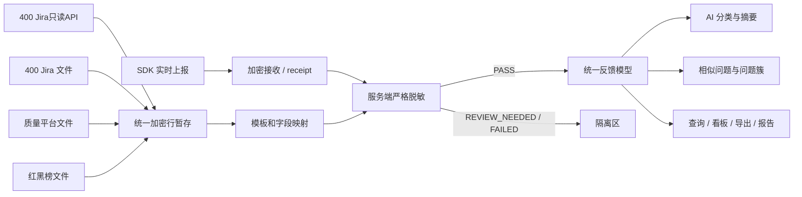
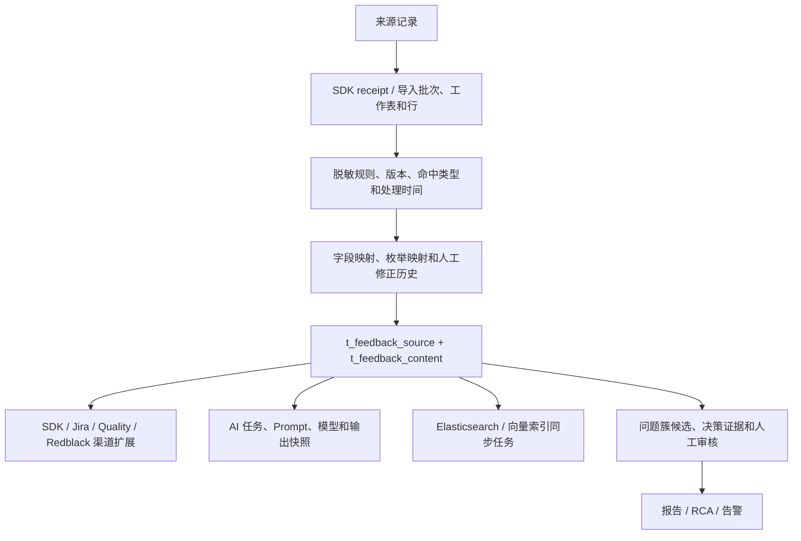

# 多渠道反馈平台技术架构

本文是代码实现的技术参考。最终交付入口见 `docs/delivery/README.md`，具体指标定义见 `docs/reference/system-metrics-guide.md`，专项验收证据见 `docs/archive/acceptance/topic*.md`。

## 1. 技术栈与运行边界

- Web：Vue 3、TypeScript、Element Plus、ECharts。
- SDK：Android/Kotlin、Room 离线队列、WorkManager 重试、AES-256-GCM、RSA-OAEP-256 和 HMAC-SHA256。
- 后端：Kotlin、Spring Boot、Spring Security、JPA/JDBC、调度 worker。
- 数据：MySQL + Flyway；Redis 用于 nonce/缓存能力；Elasticsearch 和 Milvus 为可选检索组件。
- AI：`LlmClient` 是可替换接口，默认实现为 OpenAI-compatible HTTP；向量模型支持本地 ONNX BGE-M3。

系统当前保持 44 张物理业务表。任务、评估和配置复用 `t_ai_task`、`t_import_row`、`t_system_config` 等紧凑模型；`t_jira_sync_state`只保存Jira API水位、租约和安全运行状态，不保存Token或明文地址。

## 2. 四渠道接入架构

### 2.1 SDK

SDK 使用 `app_key + client_feedback_id` 保证业务幂等。服务端先验证 HMAC、时间窗和 nonce，再保存加密信封并立即返回 `receipt_id`。正文脱密、严格脱敏、标准化、AI 和索引均在异步链路执行。附件独立加密、独立重试，并校验其所属应用和 receipt。

SDK、表格导入、AI、索引和报告使用不同 worker；单一任务失败只更新自己的重试状态，不阻断其他渠道。

### 2.2 Jira双入口与三类文件渠道

Jira API固定字段适配器与Jira文件映射器最终生成同一标准字段Map，共用加密暂存、批次Worker、Issue Key幂等、脱敏、失败重试和对账框架。质量平台、红黑榜继续使用文件入口。大于5MB的文件必须分片上传；完成请求只封存文件哈希和解析参数，后台staging worker负责组装、校验和解析。Jira API使用独立持久化水位和租约，外部契约不完整时默认关闭。

## 3. 表格增量、字段映射与幂等

处理顺序统一为：

1. 文件入口校验文件类型、大小、工作表和渠道表头边界；API入口校验连接就绪、窗口、分页和固定字段契约；
2. 使用文件 SHA-256 识别完全相同文件；
3. 绑定已发布的渠道模板及映射版本；
4. 加密保存待处理行，生成行指纹和业务键哈希；
5. 按业务键查找已有正式记录；
6. 比较行指纹和来源更新时间，判定新增、更新、重复、旧快照或冲突；
7. 完成脱敏、标准化、渠道适配和批次对账。

| 渠道 | 业务键 | 增量时间 | 映射与特有口径 | 重复处理 |
|---|---|---|---|---|
| 400 Jira | `Issue Key` / `source_record_id` | Jira 更新时间 | 状态、优先级、问题类型、项目、解决结果及版本字段；枚举按渠道配置 | 行指纹相同跳过；旧更新时间跳过；较新快照更新 |
| 质量平台 | 原文件 ID；缺失时保持既有组合键生成：`客户地址 + 故障现象确认 + 商返申请日期` 的 SHA-256 前缀 | 来源更新时间；商返申请日期作为业务发生时间 | 地址只用于生成业务键和行政区泛化，正式渠道表不保存精确地址 | 业务键相同按指纹和更新时间更新或跳过 |
| 红黑榜 | `source_record_id`；数据周期作为来源口径保留，不代替业务键 | 来源更新时间 | 保留红/黑榜、评价对象、评价维度、影响等级、周期和来源口径 | 行指纹相同跳过；新快照更新；不与其他渠道物理合并 |

文件哈希只判断文件完全重复，不能替代业务键。映射模板、枚举映射和转换历史均保存版本；质量平台来源记录 ID 的生成规则不得因表头别名或模板升级改变。

批次最终强制满足：`新增 + 更新 + 跳过 + 失败 + 待复核 = 总行数`。失败明细只输出安全错误摘要，对账文件同样执行脱敏和权限检查。

## 4. 统一模型与数据血缘

统一来源模型保存 `source_channel`、`source_record_id`、业务时间、来源更新时间、进入平台时间和导入批次；统一内容模型保存脱敏后的标题、描述、标准分类、严重度、状态、质量分和规则版本。渠道扩展表保留来源口径，但不能覆盖统一字段或其他渠道记录。

详情时间线可追踪导入位置、脱敏与映射版本、AI 模型、问题簇决策和人工修正。任务表继续保存输入/输出快照、租约、重试、耗时和结果实体，实现跨阶段追责而不复制正文原文。

## 5. 隐私、隔离和审计

- SDK 服务端接收后、表格预览和落库前必须脱敏；发送模型、向量服务、报表或导出前再次检查。
- 普通查询、搜索、看板、报告和导出只能读取 `masking_status=PASS`。
- 未通过记录进入隔离区，不进入 AI、向量和统计链路。
- 原始 SDK 信封、导入行和文件分片使用 AES-256-GCM 加密并按保留期清理。
- 原文检查只允许隐私工作台的专门权限、授权依据和审计流程；普通日志不记录原文。
- 行级权限按渠道、模块和区域收口；`FIELD` 规则对列表、详情和导出执行列级过滤，`DENY` 优先。

## 6. AI、成本和失败降级

分类输出必须符合结构化契约，包括应用、模块、类型、情绪、严重度、风险、摘要、团队、置信度和数据来源。Prompt 文件及 SHA-256 由 Git manifest 管理，发布经过结构检查、评估和双人审批；每次调用记录 Prompt、模型、token、耗时、费用和供应商请求号。

`LlmClient` 隔离模型供应商。配置支持日 token 配额、超时、重试和输入/输出单价；成本由实际 token 计算。模型不可用、配额不足或输出校验失败时，分类降级到确定性规则，报告和助手降级到程序查询事实或模板文本。连续失败触发熔断/自动回滚，不影响接入、查询和统计。

## 7. 相似问题与跨渠道去重

候选召回结合脱敏文本、应用、模块、版本、时间、错误签名和向量分数。硬冲突禁止自动合并；仅文本相似不能生成主关联。高证据候选可自动关联，边界候选进入人工审核。确认、拒绝、解除、合并和拆分均保留版本、理由及历史关联，不物理删除来源记录。

看板同时提供原始记录数和去重问题数；跨渠道合并指标按活跃 MAIN 问题簇计算，并保留各渠道来源标签和统计口径。

## 8. 数据质量与对账

系统按渠道、批次计算完整率、重复率、时间合法率、枚举合法率、映射成功率、脱敏通过率、导入成功率、跨渠道疑似重复率及隔离数量。超过配置阈值触发告警。

每个批次保存新增、更新、跳过、失败、待复核及附件可用情况；对账导出提供批次状态与安全行级结果。重新处理、技术重试、重放和回滚均受权限、状态机、时间窗口和审计控制。
